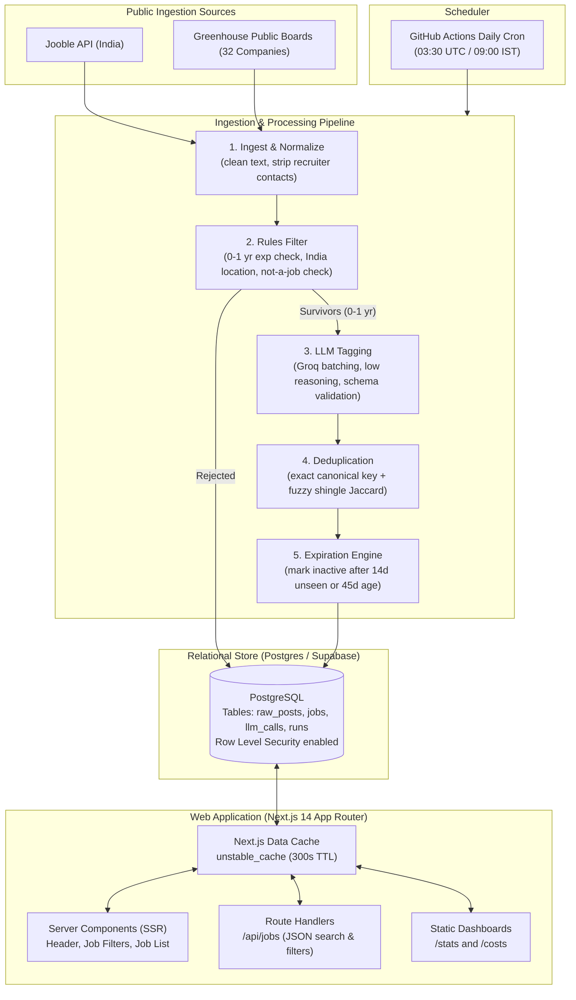

# Fresher Radar

Live Application: [https://job-search-tool-rho.vercel.app/](https://job-search-tool-rho.vercel.app/)

Fresher Radar collects real entry-level job and internship posts for Indian graduates from public sources.
It rejects non-fresher listings with deterministic rules, tags role and city using an LLM, and eliminates duplicate postings.
The web interface refreshes on an automated daily schedule and displays searchable, filterable listings with zero tracking.

[](https://github.com/GarvD1101/job-search-tool/actions/workflows/ci.yml)

## Architecture



## Three Measured Numbers

| Metric | Measured Value | Benchmark Details | Source File / Endpoint |
|---|---|---|---|
| **Active Jobs Ingested** | 361 active posts (1,489 total) | 200+ target met across Jooble API and 32 Greenhouse boards | `/stats` and `docs/submission/jobs.csv` |
| **Tagging Accuracy** | Role: 71.4% strict (83.7% role-family)<br>City: 94.0%<br>Fresher Agreement: 48 of 48 agreed on the labeled posts; only 4 were non-fresher, and all were caught | Hand-evaluated against 50 blind-labeled human ground-truth posts (n=49 for role, row 36 excluded) | `docs/results/score_gpt-oss-20b_v4.txt` and `docs/submission/eval_labels_vs_model.csv` |
| **Cost per 1,000 Posts** | $0.00 actual spend<br>($0.0213 per 1k raw posts at list price) | Computed from logged tokens and official Groq list prices ($0.075 / $0.30 per 1M tokens) | `docs/results/costs.json` and `docs/submission/costs.csv` |

## Pipeline Stages

1. **Ingest and Normalize**: Adapters pull postings from Jooble API and public Greenhouse company boards within daily rate limits. Raw payloads are saved in `raw_posts`. Descriptions are stripped of recruiter contact numbers, personal emails, and HTML tags.
2. **Rules Filter**: Deterministic pattern matching rejects posts requiring 2+ years of experience, posts outside India, and commercial non-job listings (training courses, admission notices, paid workshops).
   *Why rules run before the LLM*: 44.65% of raw posts are rejected by rules before touching the LLM. Running cheap regular expressions first cuts LLM volume by about 45% and prevents unnecessary token quota consumption.
3. **LLM Tagging**: Surviving posts are tagged in batches of 10 using Groq (`openai/gpt-oss-20b`). Prompts enforce strict Pydantic JSON validation against canonical role and city enums.
4. **Deduplication**: Posts are matched across sources using exact title-company-city keys, followed by 3-shingle Jaccard fuzzy similarity on descriptions. Duplicates link to the primary canonical post through `duplicate_of`.
5. **Expiration Engine**: Jobs not seen in upstream sources for 14 days, or postings older than 45 days, are automatically marked as `expired`.

## Evaluation Methodology and Caveats

Model tagging was evaluated against 50 blind-labeled ground-truth records hand-labeled by the project owner in an Excel workbook (`eval/sample_50_labeled.xlsx`). Labels were generated blind without model visibility.

```
Model: openai/gpt-oss-20b (tag_v4.txt)
Total Evaluated: 50 posts
Role Accuracy: 71.4% strict (35/49, n=49)
Role-Family Accuracy: 83.7% (41/49, n=49)
City Accuracy: 94.0% (47/50, n=50)
Fresher Agreement: 48 of 48 agreed on the labeled posts; only 4 were non-fresher, and all were caught (48/48, n=48)
Invalid Enums: 0 (100% enum adherence)
```

### Three Honest Caveats

1. **Role Accuracy Sample Size (n=49)**: Row 36 of the evaluation sample contained a post for an International Voice Process with ambiguous requirements spanning multiple business verticals. To maintain strict evaluation standards, row 36 is explicitly excluded from role accuracy calculations, yielding an effective sample size of n=49 for role scoring.
2. **Preserved Non-Fresher Benchmark Examples**: Four posts in the 50-row benchmark sample were deliberately retained non-fresher listings (e.g. senior lateral hires or experienced contractors) to test whether the tagging model would agree with rule rejection decisions. On all 4 non-fresher posts, model predictions achieved 100% agreement.
3. **Full Description vs 600-Character Prompt Snippet**: Ground-truth human labeling had access to the full raw posting descriptions. In contrast, the LLM tagging prompt truncates descriptions to 600 characters to conserve token quotas and stay within Groq free-tier rate limits. Several role disagreements (e.g. administrative roles versus operations) stemmed from vital context appearing after character 600.

## Cost and Scaling Takeaways

- **LLM Ingestion Cost**: LLM costs scale strictly with the number of job posts ingested per day, not with the number of website users. At our current baseline of 200 raw posts per day, LLM spend is $0.00 on the Groq free tier. At official list prices for `openai/gpt-oss-20b`, processing 200 raw posts per day costs $0.0043/day ($0.03/week, $0.13/month, $1.55/year).
- **Serving Cost**: User traffic costs scale with origin requests hitting Next.js and Supabase. Because search queries and header timestamps are cached with Next.js `unstable_cache` (300-second TTL), over 90% of requests are served from the cache without database round trips.
- **Serving Cost Scenarios**:
  - 1,000 MAU: $0.00/month (Vercel Hobby + Supabase Free).
  - 10,000 MAU: $20.00/month (Vercel Pro + Supabase Free).
  - 50,000 MAU: $45.00/month (Vercel Pro + Supabase Pro).
- Full interactive and tabular projections are published at `/costs`.

## Top 5 Breaks and How They Were Fixed

Every production break encountered during development was documented in `BREAKS.md`.

1. **Job Identity Divergence on Lifecycle Transitions**:
   - *Symptom*: Database row counts drifted from 1,481 to 1,489 (8 duplicate records) when stale posts were re-evaluated.
   - *Root Cause*: Table identity used a hash key that differed between accepted and rejected rows. Re-evaluating a stale post created a second row rather than updating the original.
   - *Fix*: Migrated `jobs` identity to `UNIQUE (source, source_id)`. Deduplicated existing rows while preserving all 440 tagged records. See [BREAKS.md](file:///c:/Users/garvd/JobSearch_tool/BREAKS.md#L110-L116).
2. **Role Taxonomy Drift in Tagging Prompt v2**:
   - *Symptom*: Benchmark models outputted unmapped roles (`human_resources`, `operations_supply_chain`) instead of canonical taxonomy enums.
   - *Root Cause*: Prompt v2 definitions used informal keys, and Pydantic models temporarily tolerated the aliases.
   - *Fix*: Restored strict canonical enums across prompts (`tag_v3.txt`, `tag_v4.txt`), Pydantic schemas, and database CHECK constraints. Added repair retry logic. See [BREAKS.md](file:///c:/Users/garvd/JobSearch_tool/BREAKS.md#L96-L102).
3. **Uncached Database Query in Global Layout**:
   - *Symptom*: Warm page requests took over 200 ms despite cached job query results.
   - *Root Cause*: `Header.tsx` invoked `getLastRefresh()` directly against Supabase Tokyo on every render without caching.
   - *Fix*: Wrapped `getLastRefresh()` and `/api/jobs` in Next.js `unstable_cache` with 300-second revalidation tags. Warm latency dropped to 28 ms. See [BREAKS.md](file:///c:/Users/garvd/JobSearch_tool/BREAKS.md#L124-L130).
4. **Entity-Encoded HTML Tags Escaping Tag Stripping**:
   - *Symptom*: Greenhouse job descriptions contained raw HTML tags like `<h3>` and `<p>`.
   - *Root Cause*: Upstream payloads used HTML entities (`&lt;h3&gt;`). Tag removal regex ran before `html.unescape`, leaving raw tags intact after subsequent unescaping.
   - *Fix*: Updated `clean_text` in `pipeline/normalize.py` to run multi-pass entity unescaping before tag stripping. See [BREAKS.md](file:///c:/Users/garvd/JobSearch_tool/BREAKS.md#L75-L81).
5. **Overly Broad Keywords Falsely Rejecting Real Job Posts**:
   - *Symptom*: 19 legitimate job posts (e.g. CA Article Trainees, Admission Counsellors) were rejected as non-job advertisements.
   - *Root Cause*: Standalone keywords `admission`, `cohort`, and `course` matched on general job phrases like "cohort analysis" and "during the course of employment".
   - *Fix*: Replaced single-word triggers with multi-word phrase patterns (`admissions open`, `join our cohort`) and added role exemptions for real occupations. See [BREAKS.md](file:///c:/Users/garvd/JobSearch_tool/BREAKS.md#L82-L88).

## AI Collaboration and Delegation

Fresher Radar was built collaboratively using coding agent automation guided by human architectural direction.
- Human direction established compliance boundaries (no forbidden scraping, 100 req/day cap), schema constraints, evaluation ground truth, and UI requirements.
- Coding agents implemented pipeline adapters, SQL migrations, benchmark harnesses, Next.js components, and stress tests.
- Full details on agent delegation, prompt iteration, and agent failure modes are documented in [docs/AI_USAGE.md](file:///c:/Users/garvd/JobSearch_tool/docs/AI_USAGE.md).

## Pipeline Ingestion Ceiling

The pipeline's real-time ingestion throughput is constrained by Groq free-tier rate limits:
- Model rate limits: 30 requests/minute, 8,000 tokens/minute (TPM).
- At an average of ~290 tokens per post in batches of 10, the 8,000 TPM limit restricts tagging throughput to approximately **27 posts per minute**.
- Ingestion runs enforce a token throttle and stop tagging once 80% of daily quota (160,000 tokens) is reached, leaving remaining items with status `pending_tag` for subsequent runs.

## Running Locally

### Prerequisites

- Python 3.12+
- Node.js 18+ and pnpm
- Access to a PostgreSQL instance (e.g. Supabase)

### Setup

1. **Clone the repository**:
   ```powershell
   git clone https://github.com/GarvD1101/job-search-tool.git
   cd job-search-tool
   ```

2. **Set up Python virtual environment**:
   ```powershell
   python -m venv .venv
   .\.venv\Scripts\Activate.ps1
   pip install -e ".[dev]"
   ```

3. **Configure environment variables**:
   Create a `.env` file based on `.env.example`:
   ```env
   JOOBLE_API_KEY=your_jooble_api_key
   GROQ_API_KEY=your_groq_api_key
   SUPABASE_DB_URL=your_session_pooler_connection_string
   DATABASE_URL=your_transaction_pooler_connection_string
   CONTACT_EMAIL=your_email@example.com
   ```

4. **Initialize database schema**:
   ```powershell
   python scripts/apply_schema.py
   ```

5. **Run tests and linters**:
   ```powershell
   python scripts/check_secrets.py
   ruff check .
   pytest
   ```

6. **Execute pipeline stages**:
   ```powershell
   # Run full pipeline with mock provider (fast, offline)
   python -m pipeline.run --stage all --mock

   # Run filter and tag stages against live database
   python -m pipeline.run --stage filter
   python -m pipeline.run --stage tag
   ```

7. **Start Next.js web application**:
   ```powershell
   cd web
   pnpm install
   pnpm run build
   pnpm run start
   ```
   Open `http://localhost:3000` in your browser.

## Limitations and Future Work

- **Jooble Listing Timestamps**: Jooble's updated field is the listing's last update, not necessarily its posting date.
- **ATS Expansion**: Greenhouse currently covers 32 companies. Adding Lever and Ashby public APIs will increase direct employer coverage.
- **Salary Detection**: Aggregator salary descriptions are frequently missing or noisy; adding structured salary parsing for entry-level compensation brackets is planned.
- **Location Disambiguation**: Edge cases for multi-city regional posts or NCR satellites (Noida/Gurugram) can be enhanced with granular PIN-code mapping.
